<a href="https://havenleno22.github.io/">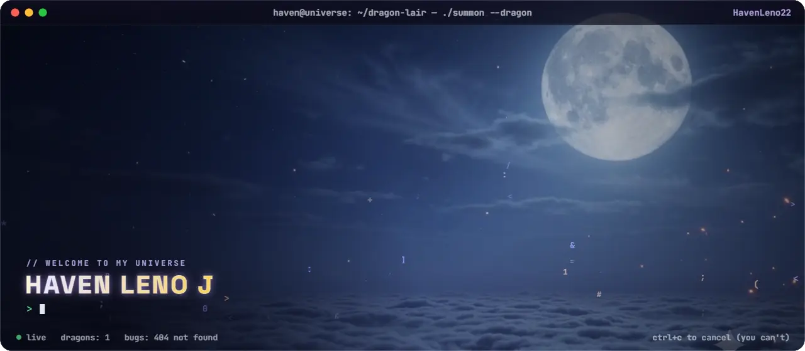</a>

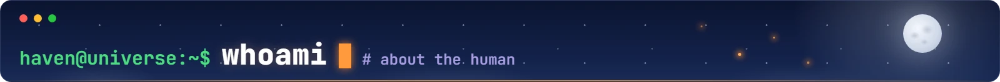

```js
const haven = {
  name:       "Haven Leno J",
  studying:   "B.Tech CSE @ SRM IST, class of 2028",
  shipped:    ["SurgeGuard", "NMDC FogGuard", "RepX", "NextUp"],
  wonAt:      "Sensora 2.0, VIT Vellore (Implementation category)",
  leading:    "a team of 6 at Smart India Hackathon 2026",
  internedAt: "GenLab, MERN stack, summer 2026",
  hookedOn:   ["web apps & UI", "backend & systems", "anything real-time"],
  afk:        ["gym", "open-world games"],
  lookingFor: "internships, Dec 2026 winter break",
};
```

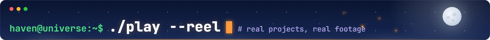

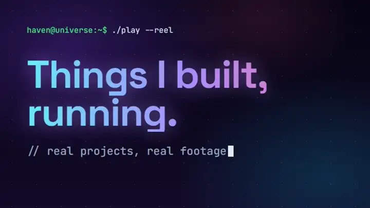

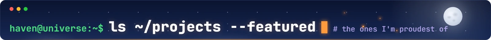

<table>
  <tr>
    <td width="50%" valign="top">
      <a href="https://havenleno22.github.io/#/project/surgeguard">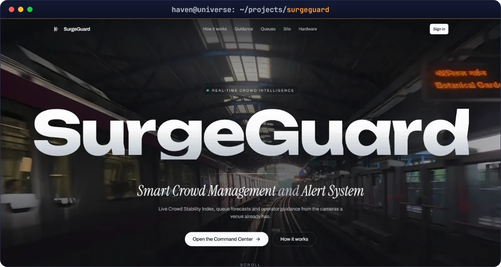</a>
      <h3><a href="https://github.com/HavenLeno22/surgeguard-crowd-safety">SurgeGuard</a></h3>
      Real-time crowd safety. Tracks people in camera feeds and scores crowd stability from 0 to 100, with alerts for security staff and an Arduino alarm.
      <br><br><sub>Python, YOLO, FastAPI, WebSockets, React, Arduino</sub>
      <br><sub><b>Winner, Sensora 2.0</b>. <a href="https://havenleno22.github.io/#/project/surgeguard">Case study</a></sub>
    </td>
    <td width="50%" valign="top">
      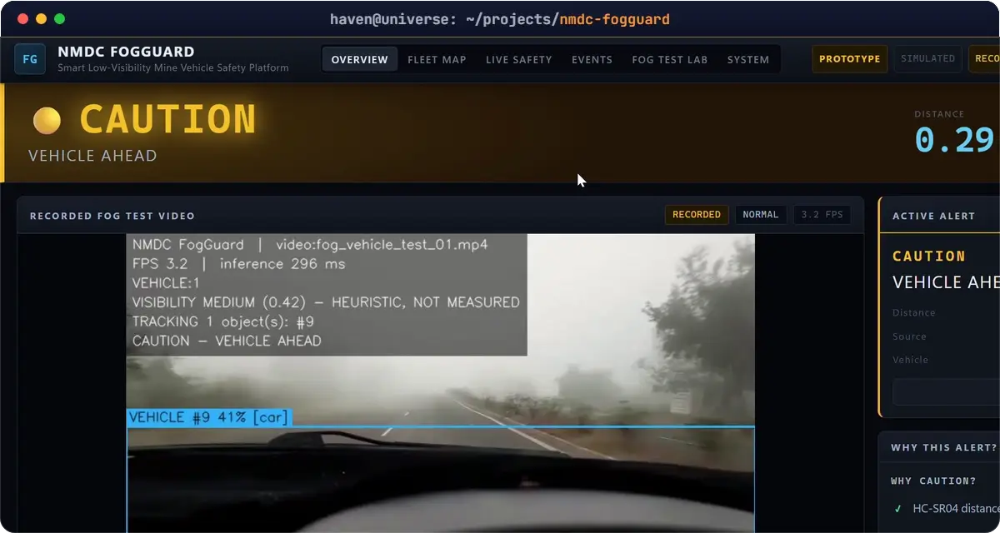
      <h3>NMDC FogGuard</h3>
      Hazard alerts for mine vehicles driving in fog. YOLO and ByteTrack find people, vehicles and animals ahead, an ultrasonic sensor adds distance, and a risk engine gives one verdict: SAFE, CAUTION or DANGER. Control-room dashboard, fleet map and in-cab driver screen.
      <br><br><sub>Python, YOLO11, ByteTrack, FastAPI, WebSockets, SQLite, ESP32</sub>
      <br><sub><b>Smart India Hackathon 2026</b>. Team lead. Private repo; hardware link tested in simulation so far</sub>
    </td>
  </tr>
  <tr>
    <td width="50%" valign="top">
      <a href="https://havenleno22.github.io/#/project/repx">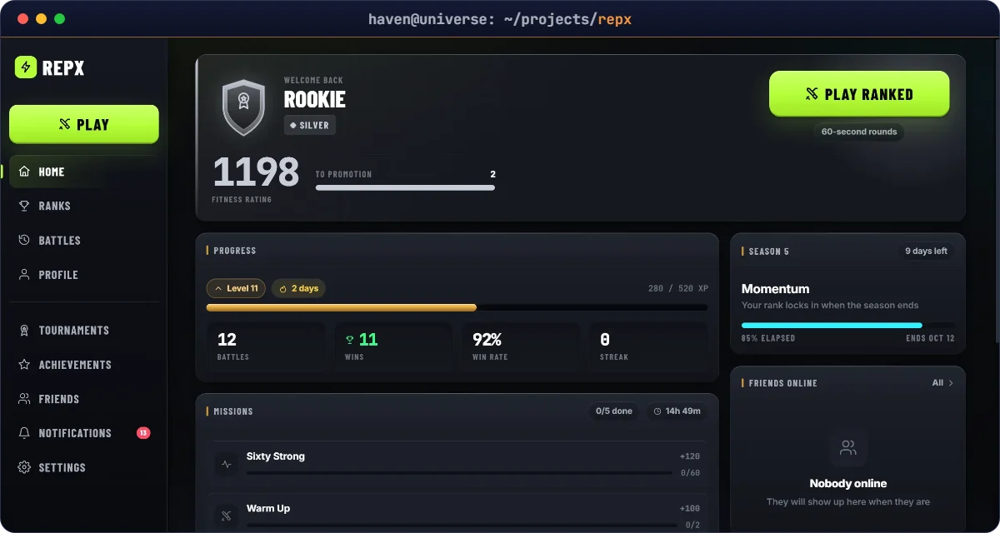</a>
      <h3><a href="https://github.com/HavenLeno22/RepX">RepX</a></h3>
      Live 1v1 fitness battles. Pose estimation in the browser counts only valid reps, and results move your ELO rating like chess.
      <br><br><sub>React, TypeScript, NestJS, Socket.IO, Prisma, MediaPipe</sub>
      <br><sub><a href="https://havenleno22.github.io/#/project/repx">Case study</a></sub>
    </td>
    <td width="50%" valign="top">
      <a href="https://havenleno22.github.io/#/project/multi-mode-ai-translator">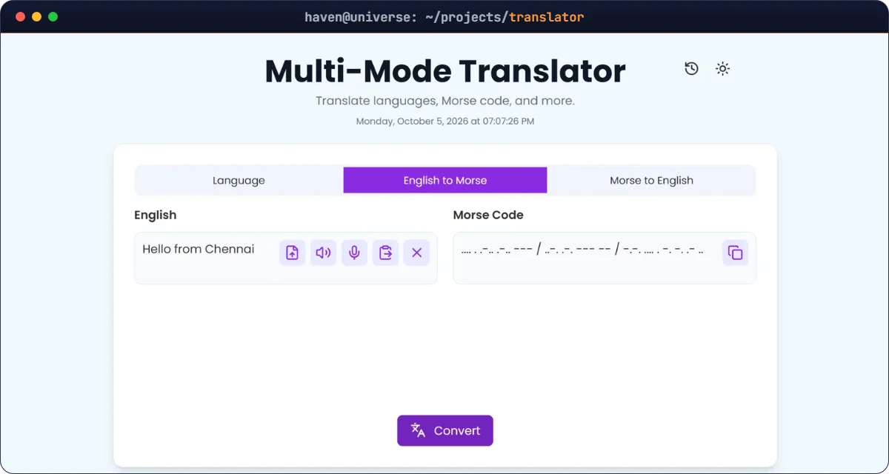</a>
      <h3><a href="https://github.com/HavenLeno22/multi-mode-ai-translator">Multi-Mode AI Translator</a></h3>
      Translation between 21 languages with the Gemini API, Morse code with a tap pad, and voice input.
      <br><br><sub>Python, Flask, Gemini API, Web Speech API</sub>
      <br><sub>Team project. <a href="https://havenleno22.github.io/#/project/multi-mode-ai-translator">Case study</a></sub>
    </td>
  </tr>
</table>

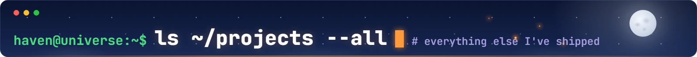

| Project | What it does | Built with |
| --- | --- | --- |
| [NextUp](https://github.com/HavenLeno22/nextup-campus-queue) | Campus queue and token system: join by QR, live place in line and wait time, staff console, TV board and analytics (team course project) | Spring Boot, React, WebSocket (STOMP), JWT |
| [Anatomix AI](https://github.com/HavenLeno22/anatomix-ai) ([live](https://havenleno22.github.io/anatomix-ai/)) | 3D anatomy learning: organs, body systems, diseases and quizzes (work in progress) | React, Three.js |
| [HealthSys EMR](https://github.com/HavenLeno22/healthsys-emr) ([live](https://havenleno22.github.io/healthsys-emr/)) | Hospital records prototype: patient charts, documents and scheduling (course project) | HTML, Tailwind CSS, JavaScript |
| [AgriTrace](https://github.com/HavenLeno22/agritrace) | Farm-to-fork supply-chain tracker, from the Hack To The Future hackathon | Node.js, Express, Gemini API |
| [StaffSync](https://github.com/HavenLeno22/staff-sync) | Employee-management dashboard with roles, charts and an audit log | Firebase, Chart.js, Tailwind CSS |
| [Student Expense Tracker](https://github.com/HavenLeno22/student-expense-tracker) | Income and spending by category with a running balance | React, Firebase |

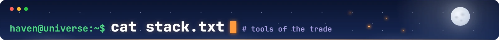

<p align="center">
  
</p>

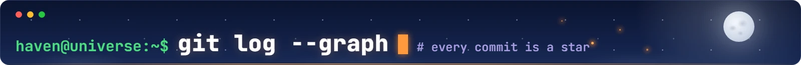

<picture>
  <source media="(prefers-color-scheme: dark)" srcset="https://raw.githubusercontent.com/HavenLeno22/HavenLeno22/output/snake-dark.svg">
  
</picture>

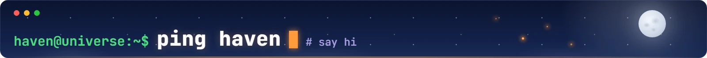

<p align="center">
  <a href="https://havenleno22.github.io/"></a>
  <a href="https://www.linkedin.com/in/havenleno"></a>
  <a href="mailto:havenleno2006@gmail.com"></a>
  <a href="https://leetcode.com/u/lenohaven/"></a>
  <a href="https://havenleno22.github.io/resume/Haven-Leno-J-Resume.pdf"></a>
</p>

<p align="center"><sub>// dragon footage generated with Veo in Gemini; terminal overlay and loop are canvas code. no dragons were harmed.</sub></p>
