

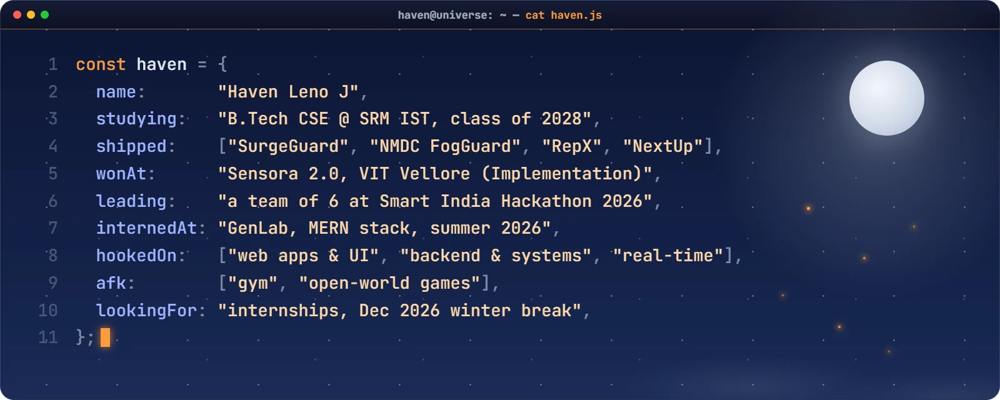

  <a href="https://havenleno22.github.io/#/project/surgeguard">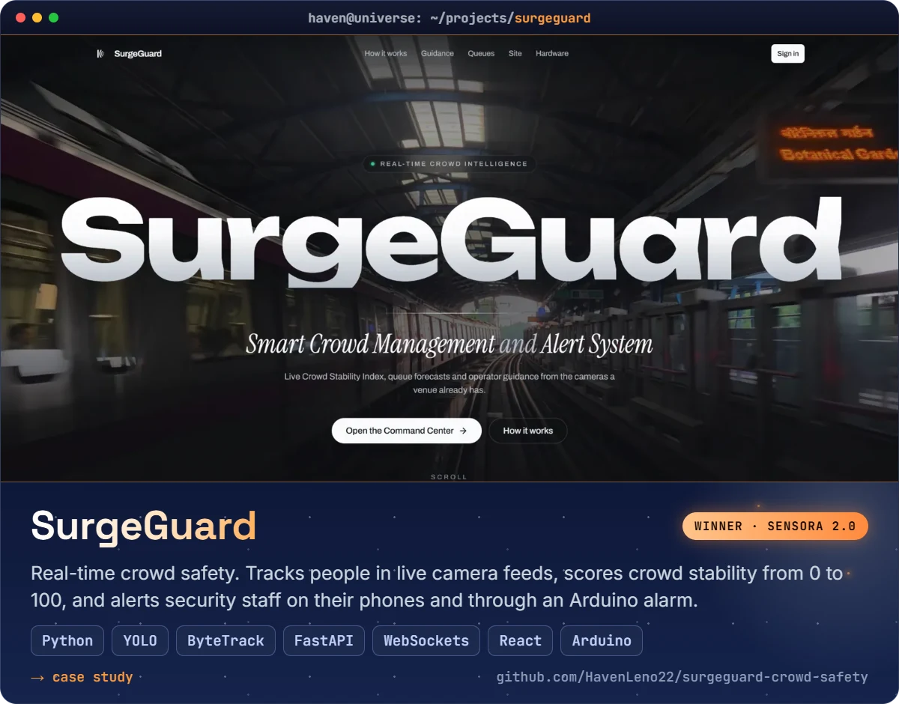</a>
  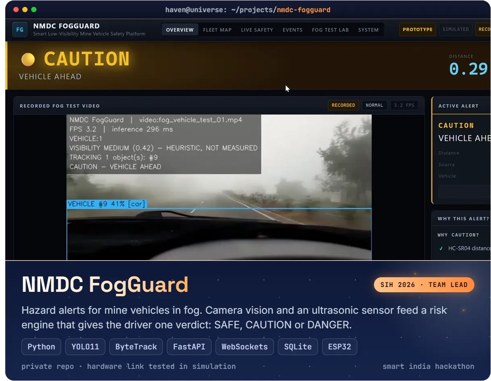

  <a href="https://havenleno22.github.io/#/project/repx">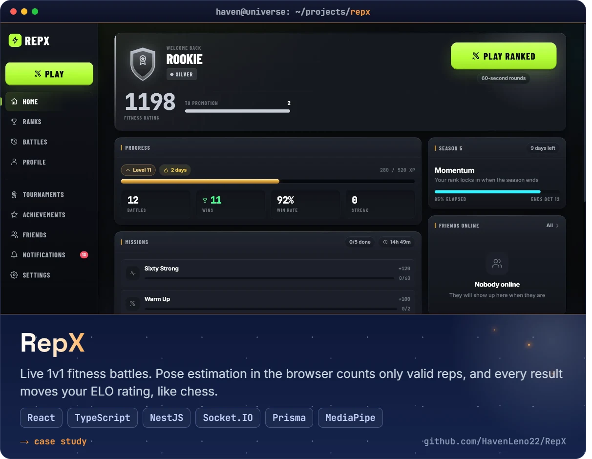</a>
  <a href="https://havenleno22.github.io/#/project/multi-mode-ai-translator">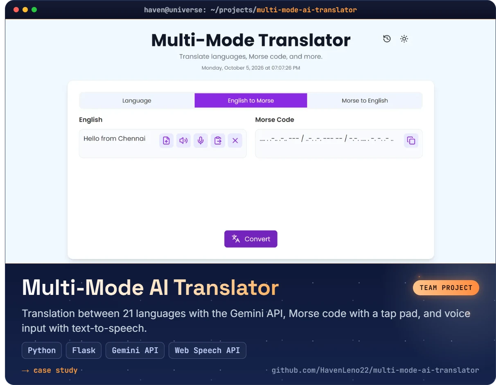</a>

source: <a href="https://github.com/HavenLeno22/surgeguard-crowd-safety">surgeguard</a> · <a href="https://github.com/HavenLeno22/RepX">repx</a> · <a href="https://github.com/HavenLeno22/multi-mode-ai-translator">translator</a> · fogguard is private for now

  <a href="https://github.com/HavenLeno22/nextup-campus-queue">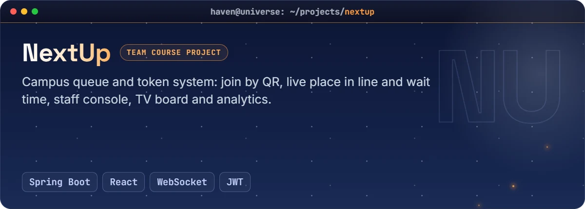</a>
  <a href="https://github.com/HavenLeno22/anatomix-ai">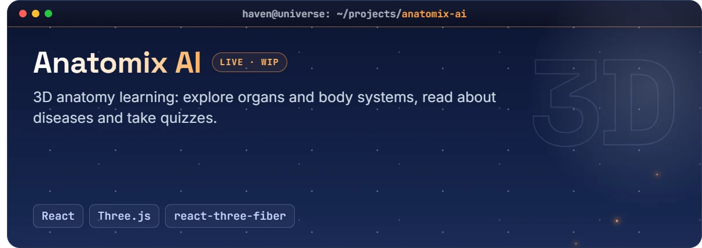</a>

  <a href="https://github.com/HavenLeno22/healthsys-emr">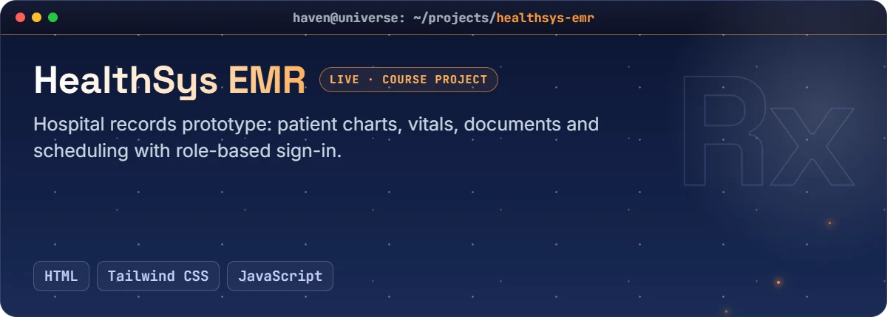</a>
  <a href="https://github.com/HavenLeno22/agritrace">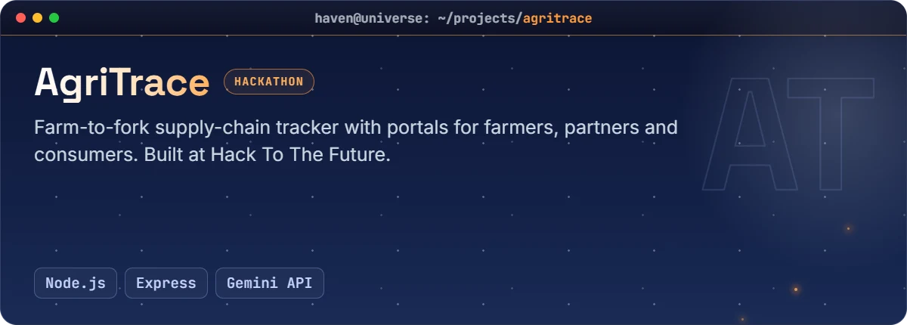</a>

  <a href="https://github.com/HavenLeno22/staff-sync">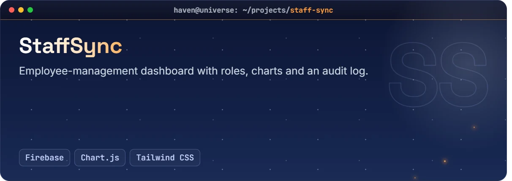</a>
  <a href="https://github.com/HavenLeno22/student-expense-tracker">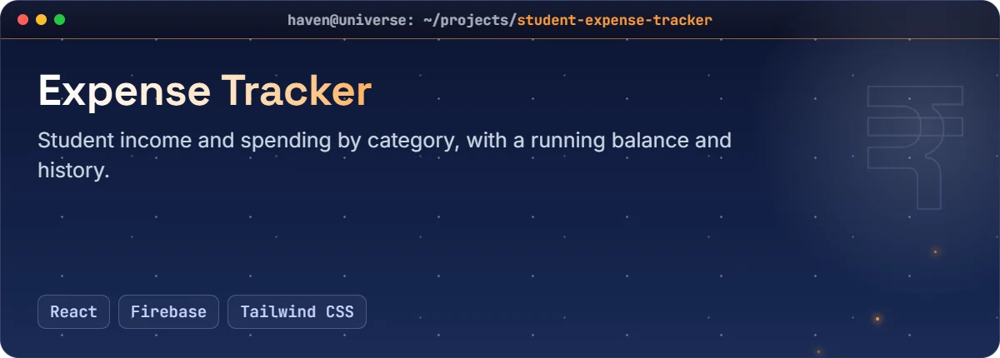</a>

live demos: <a href="https://havenleno22.github.io/anatomix-ai/">anatomix-ai</a> · <a href="https://havenleno22.github.io/healthsys-emr/">healthsys-emr</a>

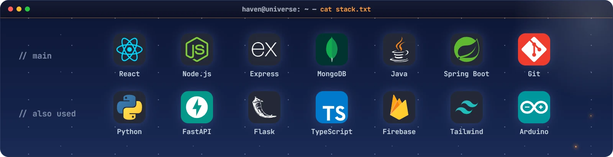

  <a href="https://havenleno22.github.io/">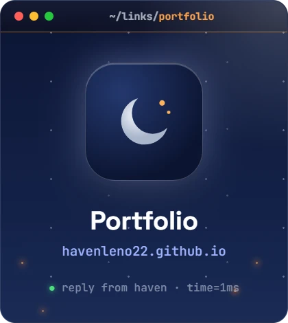</a>
  <a href="https://www.linkedin.com/in/havenleno">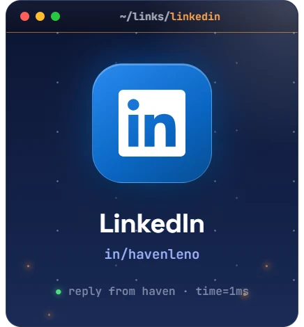</a>
  <a href="https://mail.google.com/mail/?view=cm&fs=1&to=havenleno2006@gmail.com&su=Hi%20Haven">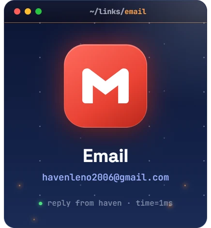</a>
  <a href="https://leetcode.com/u/lenohaven/">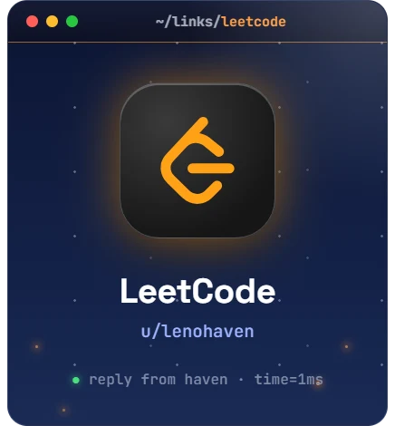</a>
  <a href="https://havenleno22.github.io/resume/Haven-Leno-J-Resume.pdf">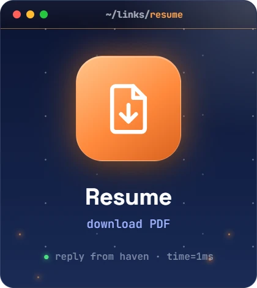</a>

// dragon footage generated with Veo in Gemini; the terminal overlay and loop are canvas code. no dragons were harmed.

